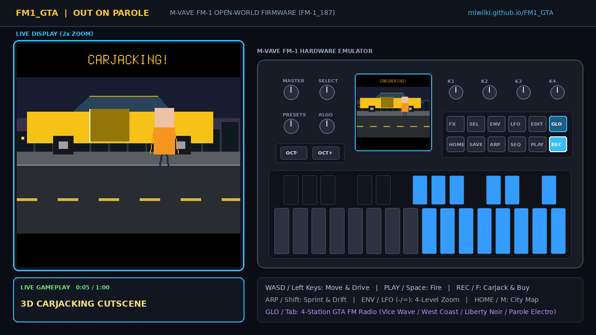
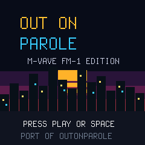
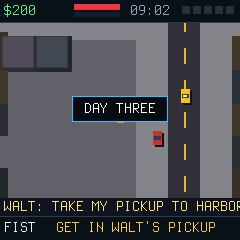
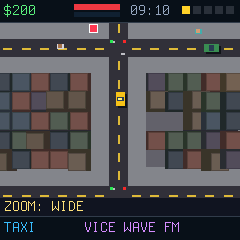
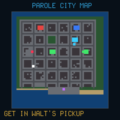
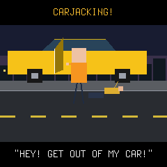
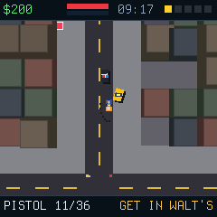
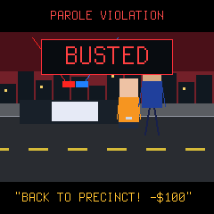

# FM1_GTA (Out on Parole — M-VAVE FM-1 Edition)

A clean, native open-world crime game firmware for the **M-VAVE FM-1** (`foma` platform, identity `FM-1_187`), ported from [shaydex-codes/outonparole](https://github.com/shaydex-codes/outonparole).

**Play & Install in Browser:** https://mlwilki.github.io/FM1_GTA/#emulator
**Watch 60s Trailer on YouTube:** https://youtu.be/-YgpPS0PEE8

[](https://youtu.be/-YgpPS0PEE8)

## Screenshots

| Title Screen | 2.5D Open City & Missions | Wide Zoom + FM Radio | Full City Map |
|---|---|---|---|
|  |  |  |  |

| 3D Carjacking Cutscene | 1★–5★ Police Chase | 3D Arrest / Busted Cutscene |
|---|---|---|
|  |  |  |

---

## How to Play

You're three days out on parole in **Parole City** — a 64×64 coastal open world with a live 24-hour day/night cycle, traffic lights, pedestrians, 10 vehicle types, 4 weapons, 5-star police chases, and a 4-station GTA-style FM synth radio.

### 1. Walt's 5 Story Missions (Orange `W` Marker)
Walk into **Walt's Lot** (west side, where you spawn) with `0` wanted stars to start each job:
1. **DAY THREE ($300):** Grab Walt's beige Pickup at the lot and drive it down to **Harbor Row** (south docks).
2. **DALE'S WAGON ($450):** Find Dale's green Wagon in **Market Row** and bring it back to Walt's Lot.
3. **SPIN CYCLE ($600):** Head to the **Market Row Laundromat**, hold **Fire** (`PLAY` / `Space`) inside to rob the register, then lose your wanted level.
4. **EXPORT QUALITY ($800):** Find the red SUV on the southeast side and deliver it to the **Docks Car Export** crane.
5. **RAY RUNS ($1,200):** Chase down and stop or wreck Ray's fleeing blue Hatchback.

### 2. Side Hustles & Landmarks (Press `HOME` / `M` for the City Map)
- **Pawn Kings Gun Shop (Green marker, East):** Walk up on foot to open the counter menu. Browse with `FX`/`SEL` (`Q`/`E` or `KNOB1`) and buy with `REC` (`F`): **Pistol ($350)**, **SMG ($1,200)**, **Shotgun ($900)**, **Ammo Pack ($120)**, **Body Armor ($400)**.
- **Respray Garage (Cyan marker, Central-East):** Drive in while wanted (with no cops right behind you) to repaint your car, repair it to 100%, and **instantly clear your wanted stars** (`$100 + $100 × stars`).
- **Docks Car Export (Purple marker, South Pier):** Drive in one of the 3 currently wanted vehicle models for a cash payout scaled by vehicle condition.
- **Taxi Fares:** Steal any yellow **Taxi** with `0` stars — passengers will wave you down (red target marker). Pick them up and race to the drop-off for fare + speed tip.
- **Store Robberies:** Stand at the **Market Row Laundromat** on foot and hold **Fire** to empty the register (triggers police heat!).
- **16 Hidden Cash Stashes:** Tucked in alleys, parks, and docks around the city (`+$250` each; nearest stash pulses on radar when you get close).

### 3. Police, Wanted Stars & 3D Cutscenes
- **Carjacking:** Walk up to any occupied traffic car or Taxi and press `REC` (`F`) to trigger the **3D Carjacking Cutscene** (press `PLAY`/`REC` to skip anytime).
- **1★ Wanted:** Police cruisers respond and officers close in on foot to arrest you — if they catch you stopped, the **3D Busted Cutscene** plays and you're released at the Police Station (`-$100`).
- **2★–5★ Wanted:** Escalating cruisers, armed officers, and at **3★+** the **Police Helicopter** locks onto you with a spotlight and overhead gunfire. Evade line of sight until your stars cool down, or hit the **Respray Garage**.

### 4. FM-1 LED Indicators & GTA Synth Radio
- **27 Key LEDs:** Flash as an alternating **red/blue police lightbar** whenever you have wanted stars (faster at higher heat). At `0` stars, they display your **speedometer** while driving or your **health bar** on foot.
- **Button LEDs:** `REC` lights up whenever you're next to an enterable car or shop; `GLO` lights when the radio is on; `HOME`/`EDIT` indicate Map/Pause.
- **FM Radio (`GLO` / `PRESETS` knob / `Tab`):** Cycles through **Vice Wave FM** (80s synthwave), **West Coast FM** (G-Funk), **Liberty Noir** (East Coast minor bass/piano), **Parole Electro**, **PD Scanner**, and **Radio Off**.

---

## Controls

| Action | M-VAVE FM-1 Hardware | Browser Emulator Keyboard |
|---|---|---|
| **Move / Steer / Gas / Brake** | Left keys: `F3` Left, `G#3` Up/Gas, `G3` Down/Brake, `A3` Right (or `OCT-`/`OCT+`, `SELECT` knob) | `W A S D` or Arrow Keys |
| **Fire / Punch / Hold-Up** | `PLAY` button (or top key `G5`) | `Space` |
| **Enter / Exit Car / Carjack / Buy** | `REC` button (or key `F5`) | `F` or `Enter` |
| **Sprint (on foot) / Handbrake Drift (in car)** | `ARP` button (or key `D#5`) | `Shift` |
| **Reload (on foot) / Horn & Cop Siren (in car)** | `SEQ` button (or key `C#5`) | `R` or `H` |
| **Prev / Next Weapon (or Shop Item)** | `FX` / `SEL` buttons (or `KNOB1`) | `Q` / `E` |
| **Camera Zoom Out / In** (`CLOSE` / `NORMAL` / `WIDE` / `SATELLITE`) | `ENV` / `LFO` buttons (or `KNOB2`) | `-` / `=` |
| **Full City Map** | `HOME` button | `M` |
| **Pause / Mission & Stash Status** | `EDIT` button | `P` or `Escape` |
| **Cycle FM Radio Station** | `GLO` button (or `PRESETS` knob) | `Tab` |
| **Save Progress to Flash** | `SAVE` button | Click `SAVE` on panel |

---

## Build & Flash

```bash
./fm1 dev     # Live browser emulator & web installer at http://localhost:8000
./fm1 build   # Compiles build/web/firmware.wasm and build/fm1-gta-0.7.fwsc
./fm1 flash   # Flashes build/web/firmware.fwsc over USB to a connected FM-1
```

## License
GPL-3.0-only. Built on the `foma` / Felucca / SLOOP / Dinghy FM-1 toolchain.
